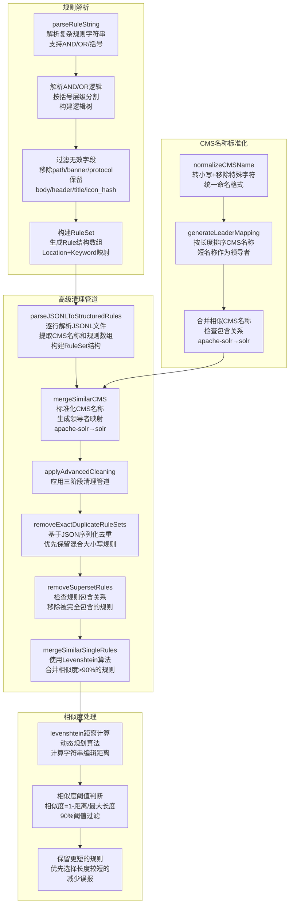
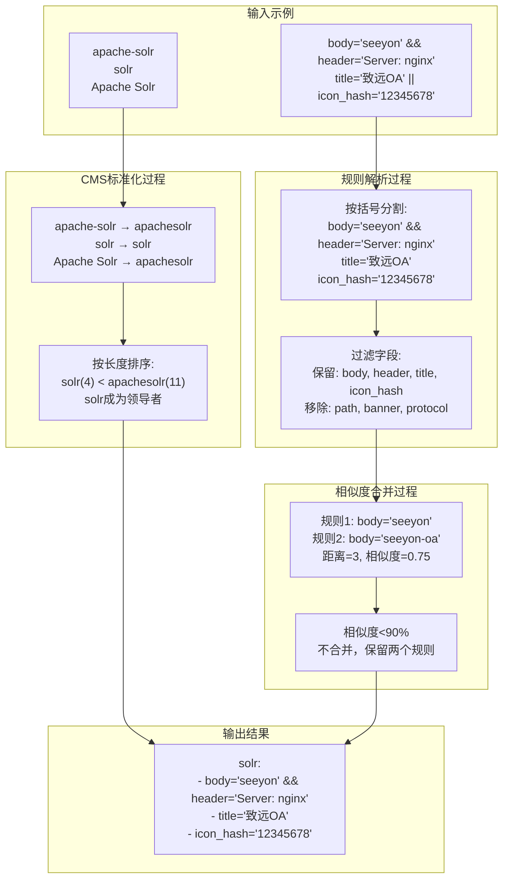

## 指纹数据处理核心流程



## 指纹处理示例流程


## 指纹内容部分示例

```yaml
1拍物联网云服务平台:
    - header="1拍物联网云服务平台"
    - title="1拍物联网云服务平台"
2zproject:
    - body="generator\" content=\"2z project"
3com-3cdsg8:
    - (title="3Com Corporation Web Interface" && body="content=\" 3CDSG8\"")
    - body="content=\" 3cdsg8\""
3com-nj2000:
    - (title="3Com Corporation Web Interface" && body="content=\"3Com IntelliJack NJ2000\"")
    - body="content=\"3com intellijack nj2000\""
```

也只是尽量处理了，并非一个完美的指纹库。
cms的总数是: count=10520，指纹库总行数 3.8w，也就是有2.8万条规则。如果只是单纯的合并指纹库，数量更多。

